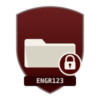

# ESAIL KMS

Training and tutorials for ESAIL, published as a browsable knowledge base.

## Available trainings

-   { width="40" } **File Naming Convention**

    ---

    How to name files consistently across ESAIL projects.

    [:octicons-arrow-right-24: Start training](trainings/file-naming-convention/index.md)

## Adding a new training

See the [Trainings overview](trainings/index.md) for how this site is organized, or the project `README.md` for how to add a new module.
