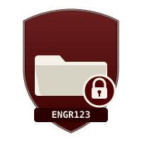

# Trainings

This is the index of all trainings and tutorials hosted in this KMS. Each training lives in its own folder under `docs/trainings/` and gets its own section in the nav (`mkdocs.yml`).

| | Training | Status |
|---|---|---|
| { width="28" } | [File Naming Convention](file-naming-convention/index.md) | Available |

To propose a new training, open a PR that adds a new folder here plus a nav entry in `mkdocs.yml`.
